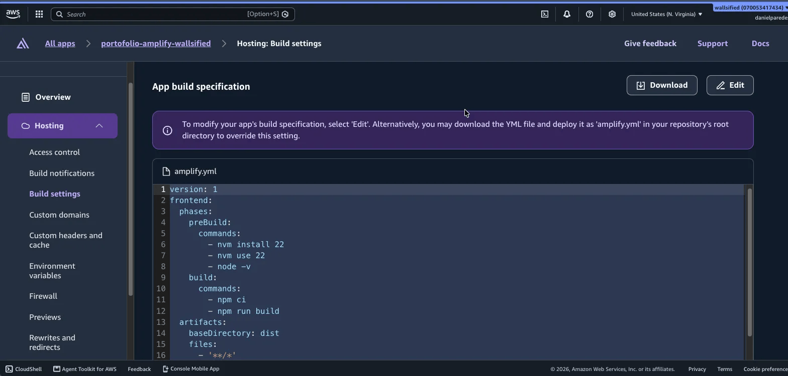
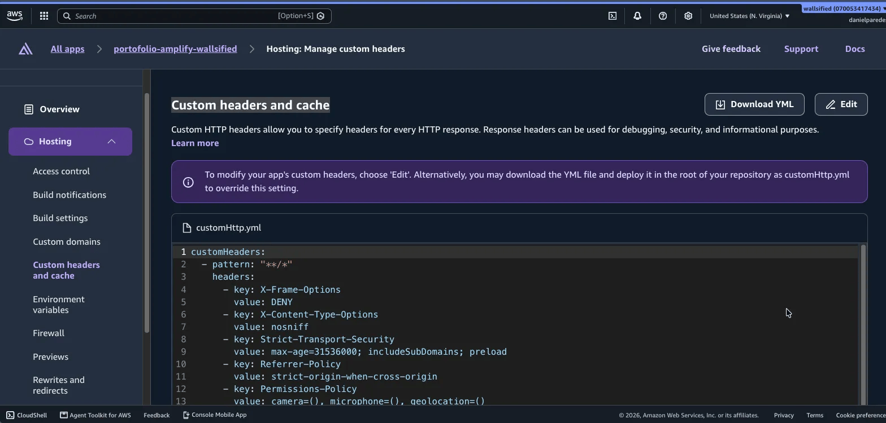
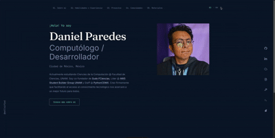

# wallsified.dev — Daniel Paredes Portfolio

Hi! This is my personal bilingual (ES/EN) portfolio, built with Astro and Tailwind CSS.

Note that the documentation within the code its in spanish, but the site and the README is available in both languages. You can switch between them with the language selector navbar button.

Site is deployed at [https://wallsified.dev](https://wallsified.dev) via AWS Amplify, with a custom domain and HTTPS. The site is fully static, with no server-side code or database.

## Stack

- [Astro](https://astro.build/) with strict TypeScript and static output
- Tailwind CSS v4
- Prettier

## Requirements

- Node.js 22

## Commands

```bash
npm run format
npm run build
npm run dev
```

## What is in this repo?

- `DESIGN.md` — Design guide: tokens, fonts, components, layout, terminal and the three easter eggs definitions
- `AGENTS.md` — Code agents working rules (stack, routes, i18n, SEO, performance)
- `agent_docs/` — real content per language (`spanish_content.md`, `english_content.md`) and reference guides; nothing in the biography is made up
- `src/` — site code: content collections in `src/content/{es,en}/`, UI strings in `src/i18n/`, components, layouts, libraries (`src/lib/`) and styles (`src/styles/`)
- `public/` — static files: images, CVs in `public/documents/`, favicon and `robots.txt`

## Adjustments for AWS Amplify

- `amplify.yml` — for build and deploy: installs Node 22 with nvm, runs `npm ci` and `npm run build`, and publishes `dist/` as static artifacts with `node_modules` cache
- `customHttp.yml` — security headers for the whole site (CSP, `X-Frame-Options`, `X-Content-Type-Options`, HSTS, `Referrer-Policy`, `Permissions-Policy`)

### Note about Amplify ajustments

Note that its completely possible to add this adjustments prior to the deployment, but the Amplify console will allow you to add them in the UI.

In `Hosting>Build Settings` you add the `amplify.yml` content:



In `Hosting>Custom Headers` you add the `customHttp.yml` content:



If you want to add a cutom domain, you can do it in `Hosting>Domain Management`. You can also add a custom domain in the UI, but you will need to add the DNS records in your domain provider.


## The easter eggs

### 1. Builder Mode

Inspired in the UI of the [AWS Builder Center](builder.aws.com), this easter egg is a hidden mode that can be activated via the `b` key or with the wrench icon. When activated, it will change the UI to a builder-like interface, with a different color scheme and layout.

### 2. Terminal

A pseudo-terminal with a command line interface that can be activated via the `t` key or with the terminal icon. It allows you to run some commands that show some information about me. Works also within the builder mode.

### 3. Cloudy with a chance of...ducks?

A hidden easter egg that can be activated via the `d` key. It will show a random number of ducks flying across the screen. Works also within the builder mode and the terminal.

## Demo video


