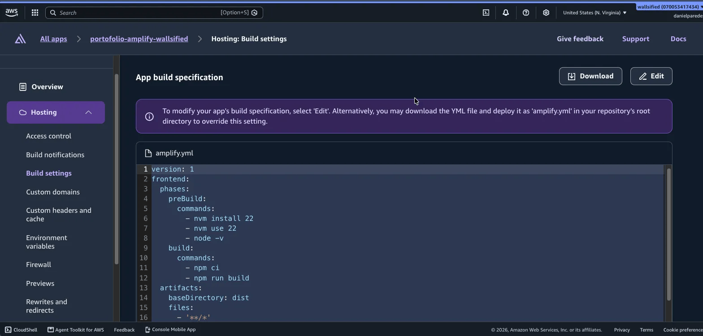
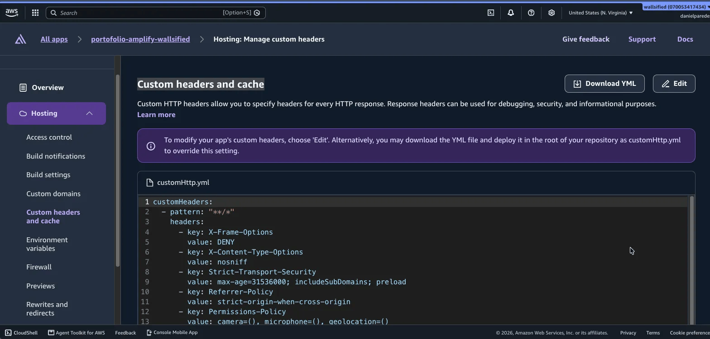

# wallsified.dev — Portafolio de Daniel Paredes

Hola! Este es mi portafolio personal bilingüe (ES/EN), construido con Astro y Tailwind CSS.

El sitio está desplegado en [https://wallsified.dev](https://wallsified.dev) con AWS Amplify, dominio propio y HTTPS. Es totalmente estático: no hay código de servidor ni base de datos.

## Stack

- [Astro](https://astro.build/) con salida estática y TypeScript estricto
- Tailwind CSS v4
- Fuentes auto-alojadas vía `@fontsource-variable` (Fraunces, Inter, JetBrains Mono)
- `@astrojs/sitemap`
- Prettier

## Requisitos

- Node.js 22

## Comandos

```bash
npm run format   # formatear con Prettier
npm run dev      # servidor de desarrollo
npm run build    # build de producción (dist/)
```

El repo incluye un hook pre-commit (husky + lint-staged) que formatea con Prettier los archivos modificados en cada commit.

## Qué hay en este repo

- `DESIGN.md` — guía de diseño: tokens, tipografía, componentes, layout, terminal y los tres easter eggs
- `AGENTS.md` — reglas de trabajo para agentes de código (stack, rutas, i18n, SEO, rendimiento)
- `agent_docs/` — contenido real por idioma (`spanish_content.md`, `english_content.md`) y guías de referencia; nada de la biografía se inventa
- `src/` — código del sitio: content collections en `src/content/{es,en}/`, cadenas de UI en `src/i18n/`, componentes, layouts, librerías (`src/lib/`) y estilos (`src/styles/`)
- `public/` — estáticos: imágenes, CVs en `public/documents/`, favicon y `robots.txt`
- `LICENCE` — licencia MIT

## Ajustes para AWS Amplify

- `amplify.yml` — build y despliegue: instala Node 22 con nvm, corre `npm ci` y `npm run build`, y publica `dist/` como artefactos estáticos con caché de `node_modules`
- `customHttp.yml` — cabeceras de seguridad para todo el sitio (CSP, `X-Frame-Options`, `X-Content-Type-Options`, HSTS, `Referrer-Policy`, `Permissions-Policy`)

### Nota sobre los ajustes de Amplify

Puedes agregar estos ajustes desde el repositorio antes de desplegar, pero también es posible configurarlos desde la consola de Amplify.

En `Hosting > Build Settings` pega el contenido de `amplify.yml`:



En `Hosting > Custom Headers` pega el contenido de `customHttp.yml`:



Para usar un dominio propio, ve a `Hosting > Domain Management`. También puedes agregarlo desde la consola, pero tendrás que configurar los registros DNS en tu proveedor de dominio.


## Los easter eggs

### 1. Modo Builder

Inspirado en la interfaz de [AWS Builder Center](https://builder.aws.com), este easter egg es un modo oculto que se activa con la tecla `b` o con el icono de llave inglesa. Al activarse, la interfaz cambia a un estilo builder, con otra paleta de colores y otro layout.

### 2. Terminal

Una pseudo-terminal con línea de comandos que se activa con la tecla `t` o con el icono de terminal. Permite ejecutar comandos que muestran información sobre mí. También funciona dentro del modo builder.

### 3. ¿Están lloviendo patos?

Un easter egg oculto que se activa con la tecla `d`. Muestra una lluvia de patos que caen por la pantalla. También funciona dentro del modo builder.

## Video de demostración


